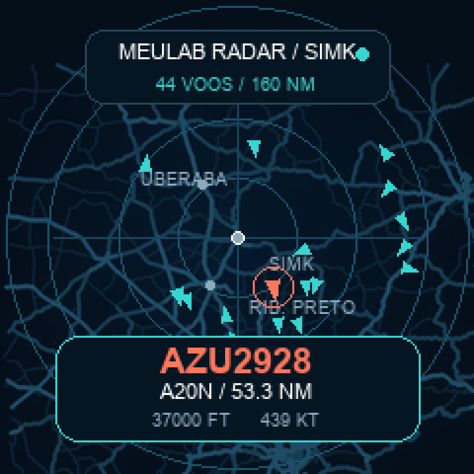

# MeuLab AirDial

[Português](#português) · [English](#english)



*Simulação da interface 240 × 240 px, ampliada para visualização. / Enlarged preview of the 240 × 240 px interface.*

## Português

Firmware de radar de aeronaves para **M5Dial**. Consulta o feed público de [Radar MeuLab](https://radar.meulab.fun/) em `https://radar.meulab.fun/data/aircraft.json` a cada 15 segundos e mostra voos sobre mapa escuro de Franca/SIMK numa tela circular de 240 × 240 px. O encoder e o botão permitem consultar aeronaves sem celular ou computador.

### Requisitos

- M5Dial ou M5Dial v1.1 (ESP32-S3, flash de 8 MB)
- Cabo USB-C com dados
- Wi-Fi de 2,4 GHz com acesso à internet
- [PlatformIO Core](https://docs.platformio.org/en/latest/core/installation/index.html)

### Configuração

```sh
cp include/secrets.example.h include/secrets.h
```

Edite `include/secrets.h` com o SSID e a senha da sua rede. Esse arquivo está no `.gitignore`: **não publique suas credenciais**. O firmware grava as credenciais no dispositivo durante a instalação.

### Compilar e instalar

```sh
pio run -e m5dial
pio run -e m5dial -t upload --upload-port /dev/cu.usbmodem2101
pio device monitor --port /dev/cu.usbmodem2101 --baud 115200
```

Troque a porta serial conforme seu sistema. No Linux, geralmente `/dev/ttyACM0`; no Windows, `COM3` ou similar. A primeira compilação baixa as bibliotecas declaradas em `platformio.ini`.

Se o upload não conectar, desligue USB, segure **G0** no módulo StampS3 atrás do Dial, reconecte USB e solte G0. A tela fica apagada no modo de gravação. Após upload, desligue e reconecte USB **sem** segurar G0 para iniciar o aplicativo. [Guia M5Stack](https://docs.m5stack.com/en/core/Dial).

### Uso

| Gesto | Ação |
|---|---|
| Girar | escolhe aeronave (dois tics = deu a volta na lista) |
| Toque | radar ↔ detalhes |
| Dois toques | liga/desliga som |
| Clique curto | radar → detalhes → estatísticas do dia |
| Segurar + girar (radar) | zoom: 160 → 80 → 40 → 20 NM (horário aproxima) |
| Segurar + girar (detalhes) | ordem: perto, altitude, recentes |
| Segurar 1,2 s | atualiza agora |
| Segurar 5 s | abre portal Wi-Fi `MeuLab-AirDial` (192.168.4.1) |

- **Desempenho:** ~25 fps no radar. Anéis, rótulos e cidades vêm gravados no mapa; varredura direto no buffer.
- **Mapa:** vias reais em azul (mais detalhe a cada zoom), anéis em 1/4, 1/2 e alcance total, cidades e SIMK. Cor da aeronave = altitude: cinza no solo, verde < 10.000 ft, ciano até 25.000 ft, lilás acima. Selecionada em coral, com rastro das últimas posições. Fora do alcance, vira seta na borda.
- **Painéis:** somem após 8 s sem uso; o indicativo da selecionada fica junto ao marcador. Qualquer gesto traz de volta. O cartão vai para o lado oposto ao voo selecionado, para não cobri-lo.
- **Alertas:** squawk 7500/7600/7700 ou campo `emergency` pisca em vermelho, seleciona o voo e apita. Voo que entra a menos de 10 NM de Franca gera aviso "PRÓXIMO".
- **Militares:** `dbFlags` do readsb. Militar em dourado (com aviso "MILITAR" ao aparecer), "interessante" em magenta.
- **Detalhes:** indicativo, registro, tipo, modelo por extenso, altitude, velocidade, razão vertical, squawk, rumo e distância.
- **Estatísticas:** voos únicos do dia, mais longe, mais alto, companhia mais frequente e militares. Zera à meia-noite.
- **Relógio:** após 60 s parado, sem voos no alcance ou à noite (22h–7h), mostra hora e voos do dia. Qualquer gesto volta ao radar.
- **Sons:** tic curto no giro, tom do zoom sobe ao aproximar, ding-dong para "PRÓXIMO", sirene em emergência (repete até tocar na tela), tom grave quando o feed cai. Silêncio das 22h às 7h, menos emergência. Som, zoom e ordem ficam salvos.
- **OTA:** com `OTA_PASSWORD` em `include/secrets.h`, grave pelo Wi-Fi: `AIRDIAL_IP=<ip> AIRDIAL_OTA_PASSWORD=... pio run -e m5dial-ota -t upload`. O IP aparece no serial ao ligar (`OTA ready: <ip>`).
- **Brilho:** menor à noite (19h–6h, horário por NTP) e após 3 min sem uso.
- **Wi-Fi:** usa `include/secrets.h` ou a rede já salva no aparelho. Sem conexão por 60 s após ligar, abre o portal de configuração sozinho.
- **Fonte:** Source Serif 4 (SIL OFL 1.1) suavizada, gerada por `tools/build_fonts.py`.
- O aro indica estado do Wi-Fi/feed. Se o feed falhar, a última leitura continua visível com a idade dos dados.

Mapas embarcados no firmware (sem tiles online). Dados cartográficos: © [OpenStreetMap contributors](https://www.openstreetmap.org/copyright), ODbL. `assets/map_*.png` e `include/map_layers.h` são gerados por `tools/build_map.py` a partir do Overpass.

### Simulador

`sim/` compila o `src/main.cpp` real no computador (M5GFX + SDL2) e gera prints de cada estado da UI, ou abre uma janela interativa. Veja [sim/README.md](sim/README.md).

O feed fornece indicativo, registro, tipo, altitude, velocidade, rumo e distância quando disponíveis. Campos ausentes aparecem como traços; nem toda aeronave transmite todos eles. A distância `r_dst` vem em milhas náuticas. A conexão HTTPS lê dados públicos sem validar certificado; não envie credenciais ou outros dados privados para esse endpoint.

### Backup e restauração

**Faça o backup antes de gravar firmware novo.** O comando abaixo lê os 8 MB completos da flash do dispositivo conectado:

```sh
esptool --port /dev/cu.usbmodem2101 --baud 921600 read-flash 0x0 0x800000 m5dial-original.bin
shasum -a 256 m5dial-original.bin
```

Guarde o arquivo em local privado. Uma imagem completa pode conter dados de Wi-Fi e outros segredos do firmware anterior. **Não adicione o backup ao GitHub.**

Para restaurar **no mesmo dispositivo**:

```sh
esptool --port /dev/cu.usbmodem2101 --baud 921600 write-flash 0x0 m5dial-original.bin
```

A restauração substitui firmware, configuração e dados da flash. Confira tamanho de 8.388.608 bytes e hash do backup antes de executar.

### Fonte dos dados

Os dados vêm de [Radar MeuLab](https://radar.meulab.fun/data/aircraft.json), não de um receptor ADS-B embutido no M5Dial. Requer internet. O feed pode ter atrasos, dados incompletos ou indisponibilidade; não use para navegação aeronáutica.

## English

Aircraft radar firmware for **M5Dial**. It fetches the public [Radar MeuLab](https://radar.meulab.fun/) feed at `https://radar.meulab.fun/data/aircraft.json` every 15 seconds and displays flights over a dark Franca/SIMK map on the 240 × 240 px round screen. The rotary encoder and button let you browse aircraft without a phone or computer.

### Requirements

- M5Dial or M5Dial v1.1 (ESP32-S3, 8 MB flash)
- Data-capable USB-C cable
- 2.4 GHz Wi-Fi with internet access
- [PlatformIO Core](https://docs.platformio.org/en/latest/core/installation/index.html)

### Configure

```sh
cp include/secrets.example.h include/secrets.h
```

Enter your Wi-Fi SSID and password in `include/secrets.h`. This file is gitignored: **never publish your credentials**. Installing the firmware writes them to the device.

### Build and install

```sh
pio run -e m5dial
pio run -e m5dial -t upload --upload-port /dev/cu.usbmodem2101
pio device monitor --port /dev/cu.usbmodem2101 --baud 115200
```

Replace the serial port for your system. Linux commonly uses `/dev/ttyACM0`; Windows uses `COM3` or similar. The first build downloads libraries declared in `platformio.ini`.

If upload cannot connect, unplug USB, hold **G0** on the StampS3 module behind the Dial, reconnect USB, then release G0. The screen stays blank in download mode. After upload, unplug and reconnect USB **without** holding G0 to start the app. [M5Stack guide](https://docs.m5stack.com/en/core/Dial).

### Use

| Gesture | Action |
|---|---|
| Turn | select aircraft (double tick = wrapped around) |
| Tap | radar ↔ details |
| Double tap | sound on/off |
| Short click | radar → details → daily stats |
| Hold + turn (radar) | zoom: 160 → 80 → 40 → 20 NM (clockwise zooms in) |
| Hold + turn (details) | sort: nearest, altitude, newest |
| Hold 1.2 s | refresh now |
| Hold 5 s | open Wi-Fi portal `MeuLab-AirDial` (192.168.4.1) |

- **Performance:** ~25 fps radar. Rings, labels and towns are baked into the map; the sweep writes straight to the frame buffer.
- **Map:** real roads in blue (more detail per zoom level), rings at 1/4, 1/2 and full range, towns and SIMK. Aircraft color = altitude: gray on ground, green < 10,000 ft, cyan up to 25,000 ft, lilac above. Selected aircraft is coral with a trail of recent positions; out of range it becomes an arrow on the edge.
- **Panels:** hide after 8 s idle; the selected callsign stays next to its marker. Any gesture brings them back. The card moves to the side opposite the selected aircraft so it never covers it.
- **Alerts:** squawk 7500/7600/7700 or an `emergency` field flashes red, selects the aircraft and beeps. An aircraft entering 10 NM of Franca triggers a "PRÓXIMO" notice.
- **Military:** readsb `dbFlags`. Military in gold (with a "MILITAR" notice when first seen), "interesting" in magenta.
- **Details:** callsign, registration, type, full model name, altitude, speed, vertical rate, squawk, track and distance.
- **Stats:** unique flights today, farthest, highest, most frequent airline and military count. Resets at midnight.
- **Clock:** after 60 s idle with no aircraft in range, or at night (22:00–07:00), shows time and flights today. Any gesture returns to the radar.
- **Sounds:** short tick per detent, zoom pitch rises as you zoom in, ding-dong for "PRÓXIMO", siren on emergency (repeats until you tap), low tone when the feed drops. Quiet 22:00–07:00 except emergencies. Sound, zoom and sort are saved.
- **OTA:** with `OTA_PASSWORD` in `include/secrets.h`, flash over Wi-Fi: `AIRDIAL_IP=<ip> AIRDIAL_OTA_PASSWORD=... pio run -e m5dial-ota -t upload`. The IP is printed on serial at boot (`OTA ready: <ip>`).
- **Brightness:** dimmer at night (19:00–06:00, NTP time) and after 3 min idle.
- **Wi-Fi:** uses `include/secrets.h` or the network already saved on the device. With no connection 60 s after boot, the setup portal opens by itself.
- **Font:** anti-aliased Source Serif 4 (SIL OFL 1.1), built by `tools/build_fonts.py`.
- The outer ring shows Wi-Fi/feed state. If the feed fails, the last result stays visible with its data age.

Basemaps ship in the firmware (no online tiles). Map data: © [OpenStreetMap contributors](https://www.openstreetmap.org/copyright), ODbL. `assets/map_*.png` and `include/map_layers.h` are generated by `tools/build_map.py` from Overpass.

### Simulator

`sim/` compiles the real `src/main.cpp` on your computer (M5GFX + SDL2) and renders every UI state to PNG, or opens an interactive window. See [sim/README.md](sim/README.md).

The feed supplies callsign, registration, type, altitude, speed, heading, and distance when available. Missing fields appear as dashes; not every aircraft broadcasts every field. `r_dst` distance is in nautical miles. HTTPS reads public data without certificate validation; do not send credentials or private data to this endpoint.

### Backup and restore

**Back up before installing new firmware.** This reads all 8 MB of flash from the connected device:

```sh
esptool --port /dev/cu.usbmodem2101 --baud 921600 read-flash 0x0 0x800000 m5dial-original.bin
shasum -a 256 m5dial-original.bin
```

Keep the image private. A full image can contain Wi-Fi credentials and other secrets from the previous firmware. **Do not add it to GitHub.**

To restore **to the same device**:

```sh
esptool --port /dev/cu.usbmodem2101 --baud 921600 write-flash 0x0 m5dial-original.bin
```

Restoring replaces firmware, settings, and flash data. Check the backup is 8,388,608 bytes and verify its hash before running the command.

### Data source

Data comes from [Radar MeuLab](https://radar.meulab.fun/data/aircraft.json), not from an ADS-B receiver inside the M5Dial. Internet access is required. The feed may be delayed, incomplete, or unavailable; do not use it for aviation navigation.
